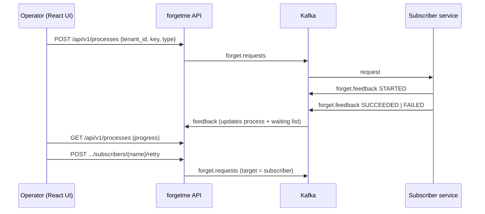

# forgetme-services

An open source **orchestrator for PII erasure** ("right to be forgotten", GDPR/LGPD).

You tell it *"forget `jane@example.com` of tenant `acme`"*. It publishes that request to Kafka,
every service that holds personal data picks it up, erases its copy and reports back. forgetme
tracks the whole thing: which services joined, what each one answered, and whether **every**
one of them finished successfully. Failed services can be retried one by one.

> forgetme never deletes data itself. It coordinates the services that do. See [ADR 0002](docs/adr/0002-orchestrator-not-eraser.md).



## Features

- Contract: `tenant_id`, `key` (the value used to find the user) and `type` (`email`, `username`; easy to extend).
- Subscribers are **discovered**: a service joins a process's waiting list by sending `STARTED`.
- A process is `COMPLETED` only when **all** subscribers on its waiting list succeeded.
- Full history of each subscriber's returns, with per-subscriber **retry**.
- React + Tailwind UI to follow processes; API and UI protected by **Auth0**.

## Stack

Python · FastAPI · SQLAlchemy 2 (async) · PostgreSQL · Alembic · Kafka (aiokafka) · Auth0 · React · TypeScript · Vite · Tailwind

## Quick start

```bash
cp .env.example .env            # fill in the Auth0 values (docs/auth0-setup.md)
make up                         # PostgreSQL + Kafka + topics
make install
make migrate
make api                        # http://localhost:8000/docs
make web                        # http://localhost:5173  (set frontend/.env from frontend/.env.example)
```

Run the tests with `make test`. Details in [docs/development.md](docs/development.md).

## Documentation

| Doc | What it covers |
|---|---|
| [docs/architecture.md](docs/architecture.md) | Layers, flow, status rules |
| [docs/messaging-contract.md](docs/messaging-contract.md) | Kafka topics and message formats (**read this to build a subscriber**) |
| [docs/subscriber-guide.md](docs/subscriber-guide.md) | How to make your service take part |
| [docs/api.md](docs/api.md) | REST endpoints |
| [docs/auth0-setup.md](docs/auth0-setup.md) | Auth0 configuration |
| [docs/development.md](docs/development.md) | Local setup, tests, migrations |
| [docs/adr/](docs/adr/README.md) | Every architectural and technical decision, with reasoning |

## Project layout

```
backend/    FastAPI service (domain → application → infrastructure → api)
frontend/   React + Tailwind UI
docs/       Documentation and ADRs
.claude/    Agents and commands for Claude Code (see CLAUDE.md)
```

## Contributing

See [CONTRIBUTING.md](CONTRIBUTING.md). Licensed under the [MIT License](LICENSE).
